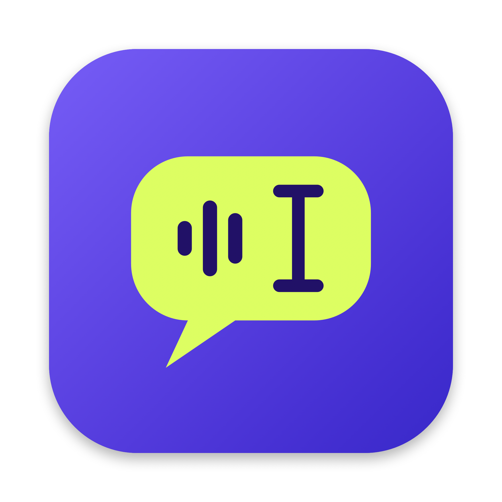
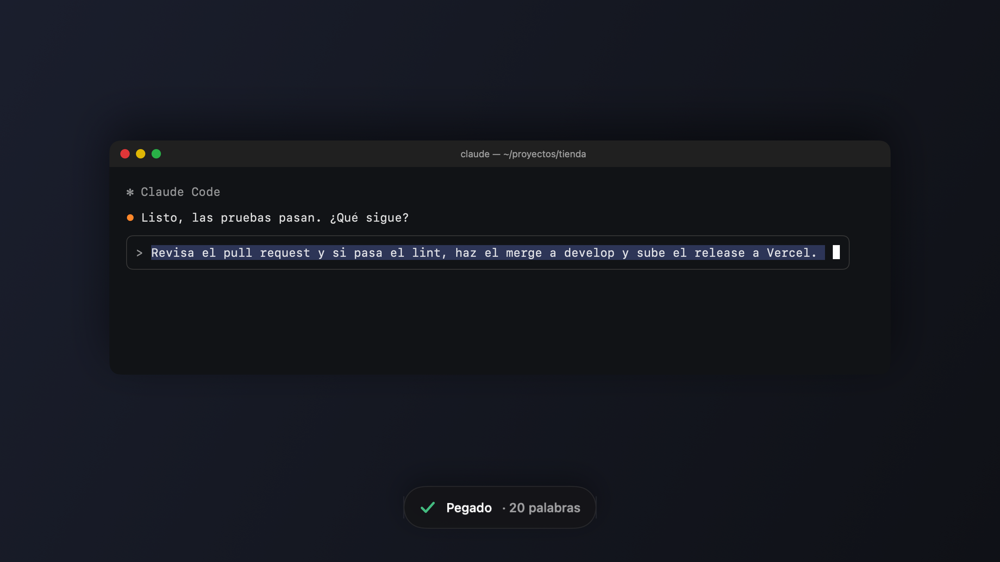
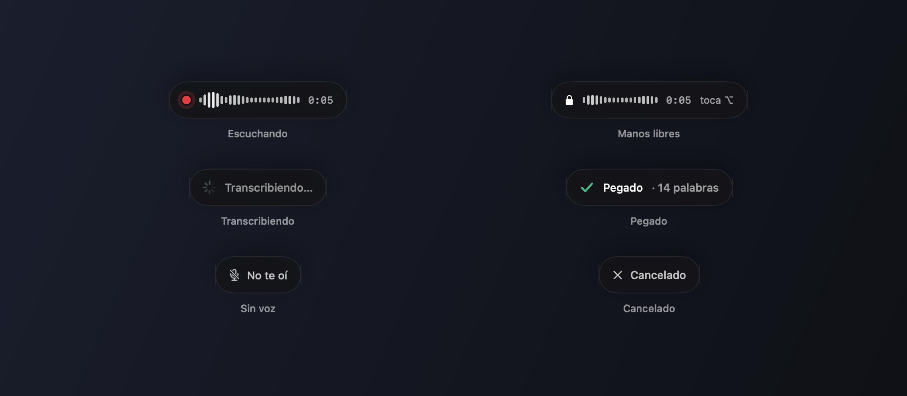
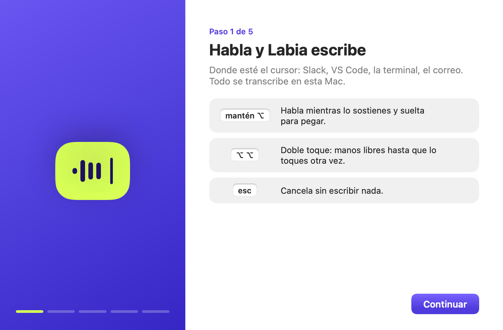
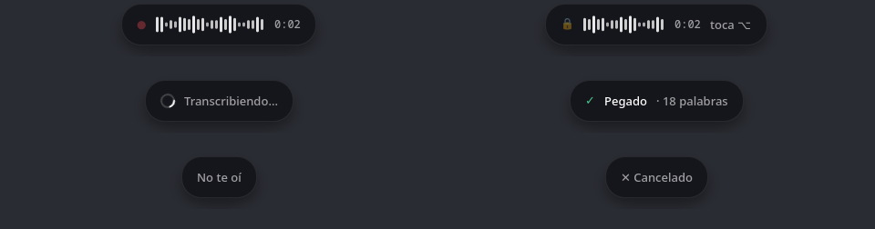
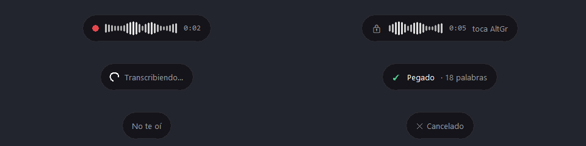
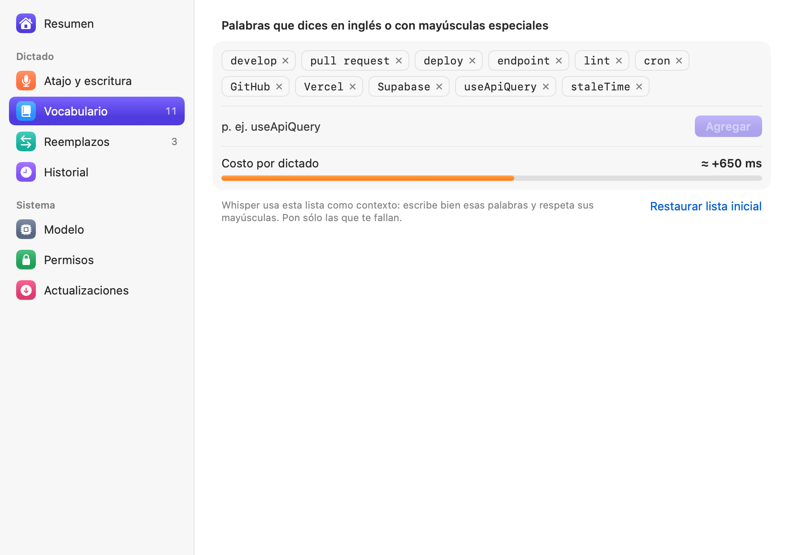
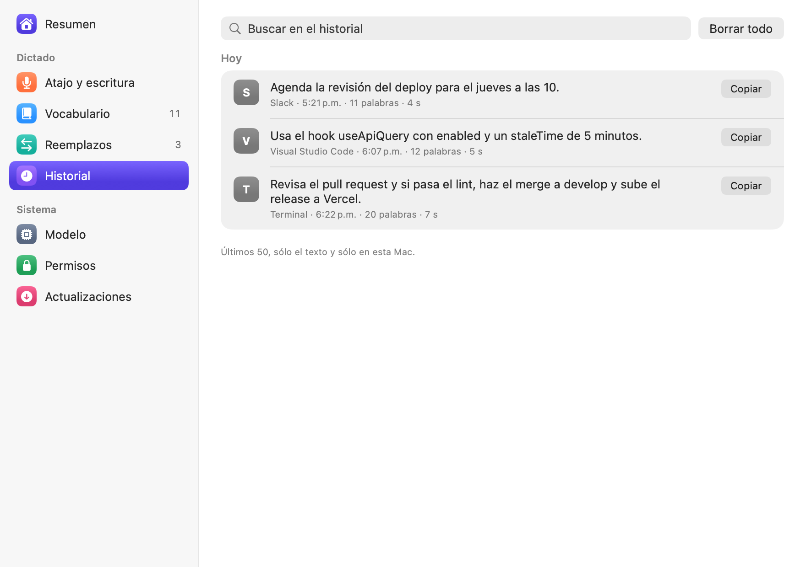

<p align="center"></p>

<h1 align="center">Labia</h1>

<p align="center"><b>Lo dices y se escribe donde está tu cursor.</b><br>
Dictado en español para macOS, Linux y Windows, en cualquier app y sin internet.</p>

<p align="center"><a href="#english">English below</a></p>

<p align="center"></p>

---

Labia vive en la barra de menú. Mantienes **⌥ derecho** y hablas: el texto aparece donde está el cursor mientras lo dices, y al soltar Labia lo corrige con una última pasada. Sirve en la terminal, el navegador, Slack, VS Code o un chat con una IA.

- **Local.** Transcribe con [Whisper large-v3-turbo](https://huggingface.co/argmaxinc/whisperkit-coreml) vía [WhisperKit](https://github.com/argmaxinc/argmax-oss-swift) en el Neural Engine de tu Mac. El audio nunca sale de tu equipo ni se guarda en disco.
- **Entiende tu spanglish.** Le das tu vocabulario (`commit`, `pull request`, `useApiQuery`, `Vercel`) y lo escribe bien, con sus mayúsculas.
- **Envía sólo si se lo pides.** Termina el dictado diciendo «Claude» y Labia quita la palabra, pega y da Enter. Sin ella, sólo pega y tú revisas. Se apaga o se cambia la palabra en Ajustes.

## Gestos

| Gesto | Qué hace |
|---|---|
| Mantener ⌥ derecho | Escribe mientras lo sostienes; al soltar sigue grabando 0.3 s (para no cortar la última palabra) y corrige con la pasada final |
| Doble toque ⌥ | Manos libres: sigue grabando hasta el siguiente toque (máximo 5 min) |
| esc mientras grabas | Cancela y borra lo que ya había escrito |
| ⌥ + otra tecla | En el primer segundo es una combinación y no dicta: puedes seguir usando ⌥ para acentos y atajos. Después se ignora y el dictado sigue |

Una cápsula abajo al centro de la pantalla te dice en qué va: escuchando (con el volumen real del micrófono), transcribiendo, pegado y cuántas palabras.

Mientras Labia escribe, no muevas el cursor. Si cambias de app, haces clic o tecleas, deja de escribir ahí para no borrar ni pegar en otro lado: el dictado completo queda en el portapapeles y la cápsula dice **«Cambiaste de lugar · quedó copiado, ⌘V»**. Si la app no recibe el pegado (no había un campo de texto activo), dice **«No se pudo pegar · quedó copiado, ⌘V»**.

<p align="center"></p>

## Instalar

Requiere macOS 14 o posterior y una Mac con Apple Silicon (M1 o más nueva).

1. Descarga `Labia-x.y.z.zip` de [Releases](../../releases) y mueve `Labia.app` a Aplicaciones.
2. La app no está notarizada por Apple. La primera vez ábrela con clic derecho → **Abrir**, o en Terminal:
   ```bash
   xattr -dr com.apple.quarantine /Applications/Labia.app
   ```
3. La ventana de bienvenida te pide tres cosas:
   - **Micrófono**, para oírte.
   - **Accesibilidad**, para detectar el atajo en cualquier app y pegar con ⌘V.
   - **Descargar el modelo**: 1.5 GB, una sola vez. La primera carga tarda alrededor de un minuto mientras macOS lo prepara para tu chip.

<p align="center"></p>

**Se actualiza sola** (desde la 1.1.0, con [Sparkle](https://sparkle-project.org)). Busca versiones nuevas cada 6 horas en los releases de este repositorio, baja la nueva en segundo plano, comprueba su firma y la instala cuando no estás dictando: Labia se reinicia y la cápsula dice «Labia se actualizó a…». Una versión que sólo cambia Windows o Linux no reinstala la Mac. En Ajustes › General se apaga o se cambia de canal (Estable o Desarrollo); en Ajustes › Modelo están la versión y «Buscar actualizaciones». Sólo se consulta github.com/ReyDavidAG/labia: no se envía nada de tu Mac.

### Compilar desde el código

```bash
git clone https://github.com/ReyDavidAG/labia.git && cd labia
swift test                 # pruebas del núcleo
scripts/bundle.sh          # arma build/Labia.app (firma ad hoc)
open build/Labia.app
```

Los permisos de macOS se amarran a la firma. Con firma ad hoc, cada compilación nueva pierde el permiso de Accesibilidad. Si tienes una identidad de firma, úsala y el permiso se conserva:

```bash
LABIA_SIGN_IDENTITY="Apple Development: Tu Nombre (XXXXXXXXXX)" scripts/bundle.sh
```

Una compilación local no se actualiza sola a menos que traiga la llave pública de Sparkle (`Resources/SparklePublicKey`). Cómo se publica una versión: [`RELEASING.md`](RELEASING.md).

Para probar el motor sin micrófono: `build/Labia.app/Contents/MacOS/Labia --transcribe audio.wav`. Las capturas de este README se regeneran con `--screenshots docs/img`. Para activar o quitar el arranque al iniciar sesión desde Terminal: `/Applications/Labia.app/Contents/MacOS/Labia --login-item on` (u `off`).

## Linux

Hay una versión para Linux en [`linux/`](linux/README.md), probada en KDE Plasma 6 (Wayland) con GPU NVIDIA. Usa los mismos gestos y la misma cápsula, y además **escribe en tiempo real**: el texto aparece mientras hablas y Labia lo va corrigiendo.

<p align="center"></p>

- **Borrador y corrección, como el `SpeechAnalyzer` de Apple.** Cada 0.5 s escribe las palabras que dos pasadas de Whisper confirman. Cada 3 s, una pasada más cuidadosa (beam 5 con detector de voz) reescribe lo ya escrito si encuentra algo mejor.
- **Sin voz no escribe nada.** La pasada final cubre toda la grabación con detector de voz, así que el silencio ya no se convierte en «Gracias.».
- **AltGr sigue funcionando.** Alt derecho solo sirve para dictar, y combinado con otra tecla llega normal a la app.
- **faster-whisper en CUDA.** large-v3-turbo en float16 sobre la GPU, o en CPU si no hay una.

```sh
sudo pacman -S --needed wl-clipboard portaudio gtk4-layer-shell python-gobject
cd linux && python -m venv .venv && .venv/bin/pip install -r requirements.txt
.venv/bin/python -m labia
```

La guía completa, con el arranque como servicio, está en [`linux/README.md`](linux/README.md).

## Windows

La versión para Windows 11 es la misma de Linux, con el atajo, la escritura y la cápsula propios de Windows: [`windows/README.md`](windows/README.md). Escribe en tiempo real, se corrige sola y se dicta manteniendo **AltGr**. Probada con GPU NVIDIA.

Se usa como app: aparece al buscar **Labia** en el menú Inicio, vive en un ícono junto al reloj (Ajustes, Historial, Pausar, Reiniciar, Salir) y tiene una ventana de ajustes con las mismas pestañas que en macOS, incluido el micrófono.

<p align="center"></p>

Para instalarla, pega esto en PowerShell (no hace falta abrirlo como administrador):

```powershell
irm https://raw.githubusercontent.com/ReyDavidAG/labia/main/windows/setup.ps1 -OutFile $env:TEMP\labia-setup.ps1; powershell -ExecutionPolicy Bypass -File $env:TEMP\labia-setup.ps1
```

Instala Git y Python si faltan, baja Labia y el modelo (unos 4 GB la primera vez), la pone en el menú Inicio, la abre al iniciar sesión y la abre. Correrlo otra vez la actualiza. Al final del comando se puede agregar `-SinInicio` (no abrirla al iniciar sesión) o `-Desinstalar`. Instalación a mano y detalles: [`windows/README.md`](windows/README.md).

## Vocabulario: precisión contra velocidad

Whisper recibe tu lista como contexto antes de cada dictado. En una prueba con 7 frases de desarrollo dichas en español:

| Configuración | Términos mal escritos | Tiempo por frase (M2) |
|---|---|---|
| Sin vocabulario | 5 (`de velo`, `Use API Query`, `style time`, `link`, `Aversel`) | ≈ 1.5 s |
| Con 19 palabras (~58 tokens) | 0 | ≈ 3 s |

Cada token del vocabulario cuesta unos 25 ms, porque Whisper lo procesa antes de empezar a escribir. La lista inicial trae 9 palabras (≈ +0.6 s): agrega sólo las que te fallen. **Ajustes → Vocabulario** muestra cuánto cuesta tu lista. Además, después de transcribir Labia une las palabras que Whisper separó (`Use API Query` → `useApiQuery`) y corrige mayúsculas de marcas (`vercel` → `Vercel`), siempre que las letras coincidan exactamente.

<p align="center"> </p>

Para lo demás están los **Reemplazos**, que traen `nueva línea` → salto de línea y `punto y coma` → `;`.

## Privacidad

- El audio se procesa en memoria y se descarta al terminar. Sólo si tú lo activas (`defaults write io.github.reydavidag.labia saveRecordings -bool true`), los últimos 20 dictados se guardan en `~/Library/Application Support/Labia/Recordings/`, con la fecha y hora en el nombre, para revisar una falla con `--simulate`. Se apaga con `defaults delete io.github.reydavidag.labia saveRecordings`.
- El historial guarda sólo el texto de los últimos 50 dictados, en `~/Library/Application Support/Labia/history.json`. Se borra desde Ajustes.
- La única conexión de red es la descarga del modelo desde Hugging Face.
- Lo que pega marca el portapapeles como transitorio, y tu contenido anterior se restaura al terminar.

## Cómo funciona

```
CGEventTap (atajo) → AVAudioEngine 16 kHz
  → cada 0.5 s: WhisperKit turbo sobre los últimos ≤10 s → LocalAgreement → retrocesos + ⌘V de lo nuevo
  → cada 3 s de audio: pasada cuidadosa que corrige lo ya escrito
  → al soltar (+0.3 s): WhisperKit + vocabulario sobre toda la grabación; si pasa de 30 s, sólo sobre los últimos
    segundos que todavía se corrigen (más 3 s de traslape, unido por el tiempo de cada palabra), cortada en pausas;
    un tramo que sale vacío con el vocabulario se repite sin él
  → limpieza (alucinaciones de silencio, vocabulario, reemplazos) → corrección final → restaurar portapapeles → historial
```

- `Sources/LabiaCore`: lógica pura con pruebas: los gestos como máquina de estados, la limpieza del texto, el dictado en tiempo real (`LiveSession`, el mismo algoritmo que `linux/labia/stream.py`), las preferencias y el historial.
- `Labia --simulate audio.wav` pasa una grabación como si se dictara en vivo e imprime cada pasada y lo que tardó.
- `Sources/Labia`: la app (SwiftUI + AppKit).

## Problemas comunes

- **No hace nada al mantener ⌥.** Si el ícono tiene un **!**, falta un permiso: Labia abre la bienvenida y la cápsula avisa «Labia perdió el permiso de Accesibilidad». Toca «Abrir Ajustes» y activa Labia en la lista. Si cambió la firma de la app, ese botón borra el permiso viejo para que macOS lo pida de nuevo.
- **Escribe "No te oí".** El micrófono no captó voz. Revisa la entrada en Ajustes del Sistema → Sonido.
- **Un dictado largo sale incompleto.** Desde la 1.2, el tramo final que Whisper dejaba vacío se repite sin vocabulario y la pasada final no borra lo que ya se escribió (máximo 5 min). Si aun así falta texto, activa `saveRecordings` (en Privacidad), repite el dictado y abre un issue con lo que imprime `Labia --simulate` con el archivo de esa hora en `Recordings/`.
- **«Cambiaste de lugar» o «No se pudo pegar».** El texto no se escribió completo para no tocar otro lugar; está en el portapapeles, pégalo con ⌘V.
- **El primer dictado del día tarda.** El modelo se libera de la memoria tras 30 minutos sin uso. Puedes cambiarlo en Ajustes → Modelo.
- **fn abre los emojis.** macOS usa esa tecla. Elige ⌥ o ⌘ derecho, o cambia en Ajustes del Sistema → Teclado qué hace la tecla 🌐.

## Licencia

[MIT](LICENSE). Usa WhisperKit (MIT) y los modelos Whisper de OpenAI (MIT).

---

## English

**Labia** is a push-to-talk dictation app for macOS, tuned for Spanish speakers who mix English tech terms. Hold **right ⌥** and speak: the text appears wherever your cursor is as you talk, a careful pass every 3 s fixes what is already typed, and on release a final pass with your vocabulary settles it (turn live typing off in Settings to paste only on release).

- Fully local. It uses Whisper large-v3-turbo through WhisperKit on the Apple Neural Engine. Audio never leaves your Mac.
- A custom vocabulary fixes code-switched terms. On an M2 a sentence takes about 1.5 s, plus ~25 ms per vocabulary token.
- Long dictations (up to 5 min) arrive complete: on release it keeps recording 0.3 s, and for anything over 30 s the final pass only redoes the last seconds. If you switch apps, click or type while it is typing, it stops typing there and leaves the whole dictation on the clipboard.
- Double-tap ⌥ for hands-free mode and press esc to cancel. It presses Enter only when you end the dictation with the send keyword («Claude» by default; change or turn it off in Settings).
- Requires macOS 14+ on Apple Silicon. Download it from [Releases](../../releases), or build it with `scripts/bundle.sh`. The app is not notarized, so run `xattr -dr com.apple.quarantine /Applications/Labia.app` after installing. From 1.1.0 on it updates itself with Sparkle (EdDSA-signed updates from this repository's releases, installed when you are not dictating).
- **Linux** (KDE Plasma on Wayland, NVIDIA GPU): see [`linux/`](linux/README.md). It types in real time while you speak and corrects itself every few seconds with a careful Whisper pass, like Apple's volatile and final results. The final pass covers the whole recording with VAD, so silence types nothing.
- **Windows 11** (NVIDIA GPU): the same Python app with a low-level keyboard hook for AltGr, see [`windows/`](windows/README.md). Install with one PowerShell line: `irm https://raw.githubusercontent.com/ReyDavidAG/labia/main/windows/setup.ps1 -OutFile $env:TEMP\labia-setup.ps1; powershell -ExecutionPolicy Bypass -File $env:TEMP\labia-setup.ps1`. It shows up in the Start menu and runs from a tray icon (settings, history, pause, restart, quit) with a settings window like the Mac one.

The UI is in Spanish. Set **Ajustes → Modelo → Idioma** to English to dictate in English.
