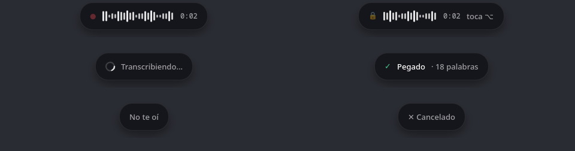

# Labia para Linux

Dictado en español con **transcripción en tiempo real**. Mantienes Alt derecho, hablas, y el texto va apareciendo mientras hablas en la app donde está el cursor. Labia lo corrige solo mientras sigues hablando. Todo es local, con Whisper large-v3-turbo en la GPU.

Probado en KDE Plasma 6 (Wayland) con GPU NVIDIA, en CachyOS. La versión de macOS está en la raíz del repo y no depende de esta carpeta.

<p align="center"></p>

## Uso

| Gesto | Qué hace |
|---|---|
| Mantener Alt derecho | Graba mientras lo mantienes, y el texto aparece mientras hablas |
| Doble toque | Manos libres hasta el siguiente toque |
| Esc | Cancela y borra lo que se escribió |
| Alt derecho + otra tecla | Pasa normal a la app: AltGr sigue sirviendo para la @ y los acentos |
| Terminar con «Claude» | Quita la palabra y presiona Enter |

Abajo al centro de la pantalla aparece una cápsula igual a la de macOS. Muestra el volumen real del micrófono y el tiempo, después «Transcribiendo…», y al final «Pegado» con el número de palabras, «No te oí» o «Cancelado». Flota sobre todo, pero no se le puede hacer clic (los clics pasan a lo que esté detrás) y no le quita el foco a la app donde escribes.

## Instalación

```sh
sudo pacman -S --needed wl-clipboard portaudio gtk4-layer-shell python-gobject
sudo usermod -aG input $USER        # para leer el atajo; cierra sesión y vuelve a entrar
cd ~/labia/linux
python -m venv .venv && .venv/bin/pip install -r requirements.txt
.venv/bin/python -m labia            # la primera vez baja el modelo (1.6 GB)
```

Para que arranque con la sesión:

```sh
mkdir -p ~/.config/systemd/user && cp labia.service ~/.config/systemd/user/
systemctl --user enable --now labia
journalctl --user -u labia -f        # ver lo que dicta
```

Los ajustes van en `~/.config/labia/settings.json`. Crea el archivo solo con las claves que quieras cambiar (ver `Preferences` en `labia/core.py`). El historial queda en `~/.local/share/labia/history.json`.

## Cómo funciona

Funciona como el `SpeechAnalyzer` de Apple: primero escribe un borrador rápido, después un resultado mejor lo reemplaza para ese mismo tramo de audio, y al final ese tramo queda fijo.

| Pasada | Cuándo | Qué hace |
|---|---|---|
| Borrador | cada 0.5 s | Whisper con beam 1 sobre el audio reciente. Una palabra se escribe cuando sale igual en dos pasadas (LocalAgreement). La última se retiene, porque la limpieza o la palabra de envío pueden cambiarla. |
| Corrección | cada 3 s | Beam 5 con detector de voz (VAD) sobre la misma ventana. Reescribe en pantalla lo ya escrito («pul request» → «pull request»). Si sale con muchas menos palabras de las que reemplaza, es una pasada mala y se ignora. |
| Final | al soltar | Beam 5 con VAD sobre **toda** la grabación, sin importar cuánto dure. Sin voz no escribe nada, así que no aparecen «Gracias.» ni «Suscríbete al canal». |

- **Teclado.** Labia toma los teclados con evdev y los reenvía por un teclado virtual uinput, menos Alt derecho cuando lo usas solo. Si la app lo recibiera, el pegado se convertiría en Alt+Shift+Insert y no pegaría nada hasta que lo soltaras. Si Labia se cierra, el kernel te devuelve el teclado.
- **Texto.** Se escribe por el portapapeles con Shift+Insert, porque es la única forma de que los acentos y la ñ salgan bien con cualquier distribución de teclado. Al terminar se restaura tu portapapeles.
- **Cápsula.** `labia/pill.py` corre como un proceso aparte con GTK 4 y `gtk4-layer-shell` (Python del sistema) y recibe los estados por stdin.

## Problemas comunes

- **Escribe «Gracias.» o frases inventadas.** El micrófono casi no capta nada. Revisa la entrada con `wpctl status` y que no esté en mute.
- **No aparece la cápsula.** Instala `gtk4-layer-shell`. Labia sigue funcionando sin ella y lo avisa al arrancar.
- **No reacciona al atajo.** Tu usuario debe estar en el grupo `input` (`id -nG`). Si conectas un teclado después de arrancar Labia, reinícialo.
- **No hay micrófono interno en laptops Intel de 12.ª gen.** El micrófono interno es DMIC y necesita SOF. Si `dmesg` muestra `CSE_IPC_RESET_PHASE_1, waiting for: CSE_CSR`, el Intel ME no valida el firmware del DSP y la solución está en el BIOS o el ME, no en Linux. Mientras tanto, usa un micrófono USB o Bluetooth.

## Pruebas

```sh
.venv/bin/python -m pytest -q
.venv/bin/python -m labia --simulate audio.wav   # 16 kHz mono; muestra cada pasada como si fuera en vivo
```
