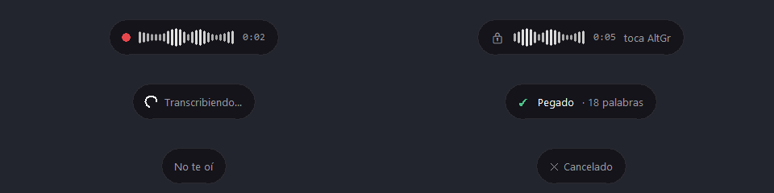
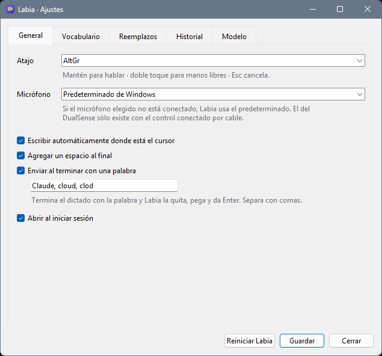

# Labia para Windows

Probado en Windows 11 con una MSI Cyborg 15 A12VF (RTX 4060 Laptop). Es la misma app que en Linux: un solo paquete de Python en `linux/labia/` que elige los módulos según la plataforma. Escribe en tiempo real mientras hablas, se corrige cada 3 s y muestra la cápsula flotante. Los gestos son los mismos: mantener AltGr, doble toque para manos libres, Esc para cancelar y terminar con «Claude» para enviar.

<p align="center"></p>

| Pieza | Linux | Windows |
|---|---|---|
| Atajo | `hotkey.py`: evdev con grab | `hotkey_windows.py`: gancho `WH_KEYBOARD_LL` |
| Escribir texto | `typer.py`: uinput + wl-copy | `typer_windows.py` + `win32.py`: `SendInput` + portapapeles |
| Cápsula | `pill.py`: GTK 4 + layer-shell | `pill_windows.py`: tkinter + estilos Win32 |
| Todo lo demás | `core.py`, `stream.py`, `engine.py`, `app.py` | igual |

## Instalar

Requiere una GPU NVIDIA con su driver al día (sin GPU funciona en CPU, pero más lento), Git y Python 3.12 de python.org, que trae tkinter. El Python de la Microsoft Store no sirve.

```powershell
winget install Git.Git Python.Python.3.12
git clone https://github.com/ReyDavidAG/labia.git
cd labia\linux
py -3.12 -m venv .venv
.venv\Scripts\pip install -r requirements.txt pytest
.venv\Scripts\python -m pytest -q
.venv\Scripts\python -m labia          # la primera vez baja el modelo (1.6 GB)
```

Cuando dice `listo`, mantén **AltGr** (Alt derecho) en cualquier campo de texto y habla. Cierra esa consola y pon Labia en el menú Inicio:

```powershell
cd ..
powershell -ExecutionPolicy Bypass -File windows\install.ps1 -Inicio   # sin -Inicio no se abre al iniciar sesión
```

Ahora aparece al buscar **Labia** en Inicio, con su ícono. `windows\install.ps1 -Quitar` borra los accesos directos.

## Usarla

<p align="center"></p>

- **Abrirla desde Inicio** muestra los ajustes. Si ya estaba abierta, los abre en esa misma: nunca corren dos Labias.
- **El ícono junto al reloj** dice en qué va (cargando el modelo, lista, en pausa). Clic abre los ajustes; clic derecho, el menú: Ajustes, Historial, Pausar, Reiniciar y Salir. Si no lo ves, está en la flecha **^** de la barra de tareas; arrástralo afuera para tenerlo siempre a la vista.
- **Pausar** ignora el atajo (para jugar o presentar) sin cerrar Labia. **Salir** espera a que termine el dictado en curso.

La ventana de ajustes tiene las mismas pestañas que en macOS:

| Pestaña | Qué cambias |
|---|---|
| General | Atajo, micrófono, escribir automáticamente, espacio al final, palabra de envío («Claude») y abrir al iniciar sesión |
| Vocabulario | Palabras que Whisper debe escribir bien, una por línea |
| Reemplazos | «Dices» → «se escribe», por ejemplo «nueva línea» → `\n` |
| Historial | Los últimos 50 dictados. Doble clic copia |
| Modelo | Idioma |

Los cambios se usan desde el siguiente dictado. El atajo, el modelo y el idioma piden **Reiniciar Labia** (botón en la ventana o en el menú del ícono).

El micrófono elegido se busca en cada dictado: si lo conectas con Labia abierta, lo encuentra; si no está, usa el predeterminado de Windows. El del DualSense sólo existe con el control conectado por cable.

Todo se guarda en `%APPDATA%\Labia\`: `settings.json` (las mismas claves que en Linux, más `input_device`) e `history.json`, en UTF-8.

## Cómo escribe

Las palabras se pegan con el portapapeles y Ctrl+V, y las correcciones borran con Retroceso. Tres detalles evitan que se pierda texto:

- **Espera a que la app lea cada pegado.** Una corrección larga puede mandar cientos de retrocesos, y la app llega tarde al Ctrl+V. Labia usa el render diferido del portapapeles: Windows le avisa en el momento en que la app lee el texto, y hasta entonces no cambia el portapapeles ni suelta Ctrl.
- **Pega en pedazos de 400 caracteres**, para que Claude Code no colapse un dictado largo en «[Pasted text]».
- **Los espacios del final los escribe con teclas**, porque Windows Terminal los recorta al pegar.

Al terminar regresa lo que tenías en el portapapeles. Lo que pega va marcado para que el historial de Win+V y el portapapeles en la nube lo ignoren.

## Problemas comunes

- **No hace nada.** Pasa el mouse sobre el ícono junto al reloj: debe decir «Lista», no «Cargando modelo…» ni «En pausa». Si el micrófono no capta nada, elige otro en Ajustes → General.
- **La cápsula muestra ⚠ y un error al empezar.** No se pudo abrir el micrófono: está desconectado o lo usa otra app en modo exclusivo.
- **Buscas Labia en Inicio y no sale.** Corre `windows\install.ps1` (ver «Instalar»).
- **No escribe en una app.** Windows no deja que una app normal mande teclas a una que corre como administrador. Ahí sólo funciona si Labia también corre como administrador.
- **Una imagen copiada desaparece.** Sólo se restaura el texto del portapapeles.
- **Avisa que no puede crear enlaces simbólicos al bajar el modelo.** Es sólo una advertencia de Hugging Face; el modelo se baja igual.
